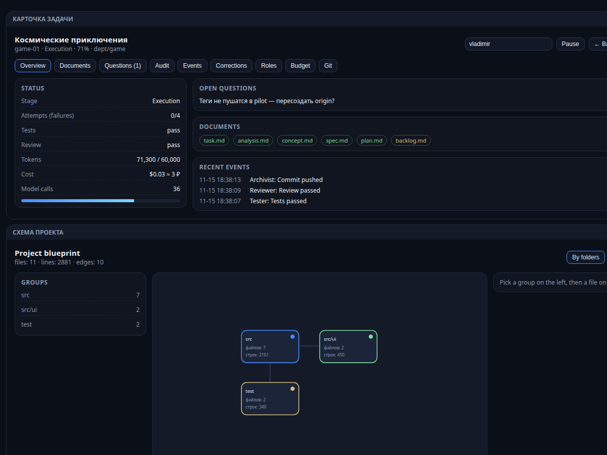
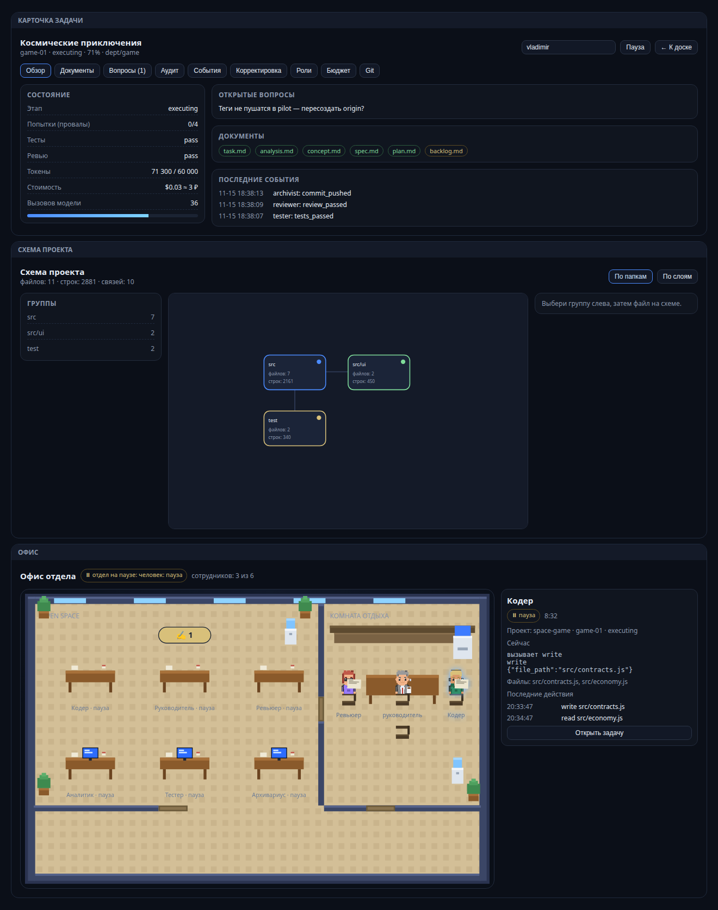
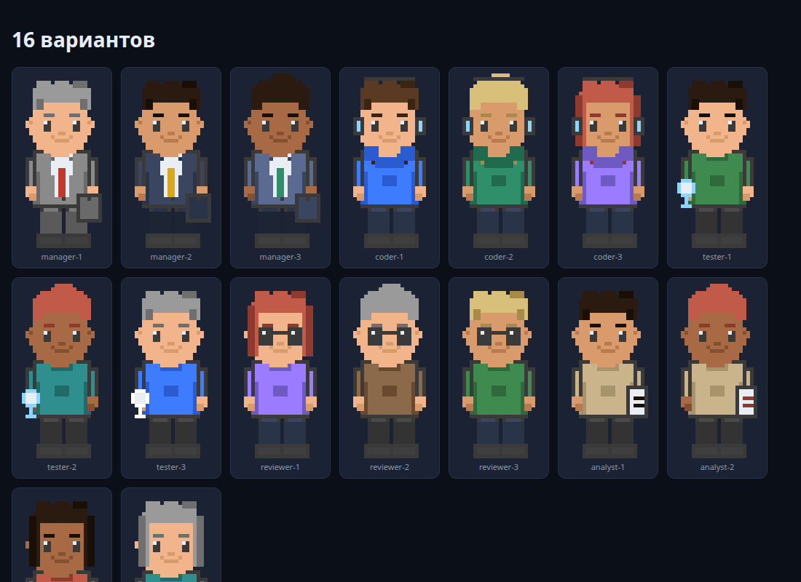

# dsh-department — AI development department for DeepSeek Harness

**English** · [Русский](README.ru.md)


The plugin turns DeepSeek Harness into a **development department**: a task goes through
analysis → concept → specification → plan → stages, and inside each stage — implementation,
tests, independent review and a tagged commit. The human approves only the concept and the
specification; everything else the department decides itself under the autonomy policy.

## Screenshots

| Department panel (EN) | Office: working |
|---|---|
|  |  |

| Paused: everyone in the lounge | 16 characters |
|---|---|
|  |  |

## Features

- **Task board** across projects: stage, progress, gates, last event.
- **Task card** with tabs: overview, documents, questions, audit, events, corrections,
  roles, budget, git; approval buttons, answers, amendments.
- **Department office**: who is working, at which desk, what they do; click — project,
  task, files and action history.
- **Project blueprint**: files and import edges grouped by folders, drill-down to a file.
- **Budget**: token usage per session, cost by price per 1M, task limit.
- **Reporting**: `dept_report` — stage, gates, who is busy, open questions.
- **Questions to the human** (`dept_ask` / `dept_answer`) — the department does not stop.
- **Spec amendments** (`dept_amend`): human-signed or autonomous (with a limit).
- **Retries** by the loop data → analysis → plan → changes → tests; retry without analysis
  is blocked; a repeated failure moves the stage to `blocked`.
- **Git**: stage commit, tag, push branch and tags; commit is blocked without fresh gates.

## Install

The plugin is installed into a DSH profile as a local (`link:`) package or from the registry:

```bash
dsh plugin add link:/path/to/dsh-department
# or from npm:
dsh plugin add dsh-department
```

Then enable the `dsh-department` bundle in the plugin manager and reload the tab.
The sidebar shows “Department”, the main window shows the board, office and blueprint.

## Model tools

| Tool | Purpose |
|---|---|
| `dept_start` | create a task: state, branch, task.md |
| `dept_status` | task state and summary |
| `dept_stage` | stage transition (except approvals) |
| `dept_approve` | human approval of concept/spec |
| `dept_gate` | tests gate (exit code) or review gate (PASS/FAIL) |
| `dept_verify` | audit: state ↔ artifacts ↔ git |
| `dept_commit` | stage commit, tag, push |
| `dept_amend` | document amendment (human-signed or `autonomous`) |
| `dept_ask` | question to the human without stopping work |
| `dept_answer` | human answer to a question |
| `dept_report` | department status report |
| `dept_health` | “is the department alive”: working / idle / waiting for human / ready to commit |
| `dept_modules` | module plan and file ownership for parallel work |
| `dept_art` | draw a pixel sprite and save a PNG |
| `dept_pixelize` | PNG/JPEG → pixel grid + palette + sprite (for redrawing from a reference) |
| `dept_compose` | compose a large PNG from small sprites (canvas, background, layers) |
| `dept_roles` | roles and models (researcher, designer, artist, senior-coder, supervisor, beta-tester, ...) |
| `dept_bug` | beta-tester bug report (steps, expected/actual, severity) |
| `dept_browse` | browser: open localhost/file, clicks, typing, screenshot into evidence |
| `dept_gui` | native app: command, env, timeout, output, screenshot via hook/command |

## HTTP API

| Route | Method | Purpose |
|---|---|---|
| `/api/department/tasks` | GET | tasks across projects |
| `/api/department/task?root=&taskId=` | GET | task card |
| `/api/department/activity` | GET | live agent activity |
| `/api/department/approve` | POST | approve a document |
| `/api/department/answer` | POST | answer a question |
| `/api/department/amend` | POST | sign an amendment |
| `/api/department/budget?root=&taskId=` | GET/POST | budget and prices |
| `/api/department/blueprint?root=` | GET | project blueprint |
| `/api/department/asset?name=` | GET | office assets |

## Process rules

1. Stages: `analysis (discussion) → spec → spec_review → concept → concept_review → executing → release → done`.
   `release` is production preparation: `dept_handover` builds `delivery/` with RUN.md,
   MANUAL-QA.md, CHANGELOG.md and copies of the key documents; `done` is blocked without it.
2. First comes the **task discussion**: the department asks questions and gathers requirements.
   Then **spec and concept in any order** (iteratively): start from the spec (`spec.md`) or from
   the concept (`concept.md`) with the architect's options; after the first document is approved
   the department moves to the other and refines it. Approvals are human-only (`dept_approve`);
   the project starts (`executing`) only when **both** are approved.
3. The first execution step is the **plan** (`plan.md`), then stage-by-stage work.
   The three key documents — **spec, concept, plan** — are always current: changes go through
   `dept_amend`/`dept_section`; the Documents tab pins them at the top.
4. Each stage is closed by a commit tagged `stage-N`; the tag is pushed with the branch.
5. Gates reset after a commit: a previous stage's pass does not carry over.
6. A test failure writes `stages/NN/failure.md`; retry is forbidden until “Analysis” and
   “Plan” are filled in.
7. Autonomous amendments — at most 5 per task, then escalate to the human.

## Working together on concept and spec

- Each specialist writes their section via `dept_section` (designer — style, artist — what
  to draw, researcher — data and statistics, tester — verification strategy, architect —
  decisions, analyst — requirements).
- The architect frames contested decisions as ideas (`dept_ideas`): 2–3 options.
- Specialists review ideas (`dept_critique`): `approve`/`reject` and severity. A hard reject
  (`high`) kills the idea; two approvals without hard criticism accept it. A rejected idea is
  not taken into work — the architect proposes a new one.
- The researcher can collect statistics and facts on the internet.

## Autonomy (goal instead of a timer)

- The manager creates a goal: “bring the task to done by plan.md” and does not close it until
  the end. DSH drives the rounds itself — no timer needed.
- Each round: `dept_health` → if `stalled`, find the cause and call a specialist:
  data — researcher, visuals — designer, images — artist, conflict — supervisor,
  architecture — architect, integration fixes — senior-coder.
- `waiting_human` does not stop the work: the team decides, the memo waits for the human.
- Protection from empty rounds: if 2–3 rounds bring no new events — record `blocked` and a
  memo instead of spinning.
- When a task is done — move to the next one; when all are closed — a party (office banner).

## Autonomy

- The manager calls `dept_health` after every step and does not stop:
  `stalled` → next plan step, `waiting_human` → decides tactically itself,
  `ready_to_commit` → verify and commit.
- For long tasks a goal is created so rounds run without human involvement.
- `supervisor` analyses stagnation and decides as a customer would.
- `researcher` searches the web, `designer` picks visuals, `artist` draws via `dept_art`.
- Parallel work: `dept_modules` assigns files to modules, coders do not overlap,
  `senior-coder` assembles and assigns follow-ups.

## Testing

- **Tester** — automated checks: tests, invariants, exit code. This is the stage gate.
- **Beta-tester** — plays/works as a user: walks scenarios, catches confusing places,
  broken flows, visual bugs; files a bug report via `dept_bug` (steps, expected/actual,
  severity, evidence). For games/UI it uses `dept_browse`: opens the page, clicks, types and
  attaches a screenshot to the report.
- Before a release the manager runs a beta test and triages bugs: critical — into work,
  the rest — into the backlog.

### Native applications (C++/Qt)

- `dept_gui` runs a program with arguments/env and a timeout, captures the output.
- Screenshot: either the app saves a frame itself by flag (`--screenshot file.png`,
  `QWidget::grab()` / `QQuickWindow::grabWindow()`), or an external command
  (`import -window root shot.png` under Xvfb).
- Recommended for Qt: a test hook `--scenario`/`--selftest` that walks a scenario and saves
  screenshots; then the beta test is deterministic and works in CI.
- Interactive GUI automation (mouse clicks) needs Xvfb/xdotool; the current environment does
  not have them, so the bet is on application hooks and Qt Test.

## Release preparation (a standard phase)

The office does not only build the product but also ships it. A release is not a one-off
request but a phase after `done`:

- `dept_start release=true` — the task brief gets the `templates/release.md` template
  (package, user documentation, QA checklist, changelog, version, tag, handover);
- artifact: `release/<product>-<version>/` + `.zip`;
- documentation: `README.md` (run, controls), `MANUAL-QA.md` (manual testing),
  `CHANGELOG.md`, known limitations;
- verification: project tests, `dept_verify`, beta test by the checklist (`dept_bug`);
- commit: `dept_commit` with tag `v<version>`, tag pushed to remote;
- report: where to get it, how to run, what to check by hand.

Release acceptance criterion: the human takes the artifact and runs it without hints; the
documentation answers “how to run”, “what it can do”, “what is limited”.

## Document library and event log

- The “Documents” tab is like mail: on the left a list of documents (search by title, filter
  by type, sort by date), on the right the content.
- Types: memo, stage report, review, bug report, specialist section, rework plan, spec,
  concept, plan, backlog.
- The “Events” tab — list on the left, details of the selected event on the right.
- Markdown in documents is rendered as markup: headings, lists, tables, inline code and code
  blocks with highlighting (JS/TS/C++/Python keywords).
- Memos waiting for a decision are marked “REQUIRES DECISION” and raised to the top of the
  list; the board shows a “✍ N” badge on the task, the office shows a yellow marker above the
  manager, the card header shows the memo count.

## Goals

- Before `update_goal` always call `get_goal` and use the current revision.
- A `stale goal ref` error means the revision has already changed: re-read `get_goal` and
  retry once with the new revision — do not guess.
- Pausing the department does not pause the goal: the goal lives separately (that is DSH).

## Pause and resume

- `dept_pause` (or the button in the card) — the task is paused: gates, commit and amendments
  are blocked, no tokens are spent, the state stays on disk.
- The watchdog does not wake a paused task.
- `paused=false` (human signature) — work continues from the same place, including after a
  server shutdown/startup.
- The office shows the pause: a “department paused” banner and the manager sits in the lounge.

## Multilingual UI

The panel interface is **Russian and English**:

- an **EN/RU** button in the board header; the choice is remembered (`localStorage['dept-lang']`);
- by default — the browser language, falling back to Russian;
- translated: navigation, task card, tabs, stages, events, audit, document types, roles,
  budget, office, project blueprint, charts.
- **Document content** is written by agents in the task language — it is not UI strings; the
  documentation language is set in the brief (`lang` in task.md) or in the prompt.

Dictionary: `LOCALES` in `client.js` (ru/en), `dot.case` keys, `{n}` interpolation.
Roadmap — `docs/I18N.md`.

## Incoming-data watchdog

- Every 5 minutes the plugin checks department tasks: new corrections (`new`), answers to
  questions (`answered`), remarks on memos (`changes_requested`).
- If new data appears, it collects a package and wakes the manager (`followup`), once per new
  item; it does not resend the same thing.
- If the manager is busy, the watchdog waits for the next check.
- **Anti-stall**: if the task is active (not paused/done/blocked), the agent is idle, and the
  last event is older than 15 minutes — the watchdog wakes the manager with a hint
  (dept_verify/commit or the next step). At most once per 30 minutes per task.

## Corrections

- The “Corrections” tab is a letter to the manager: what it relates to (concept/spec/plan/
  code/data/interface), subject and text. It is stored in the correction history.
- `dept_correction` — the manager sees the list, takes it into work (`in_progress`), gathers
  specialists for analysis and closes it (`done`) with a summary.
- Corrections are used to update the concept, spec and plan (`dept_amend`, `dept_section`).

## Post-release remarks

- remarks on a finished project go into the **same task**: `dept_reopen` (the “Reopen”
  button in the card) returns it to `executing` without creating a v2;
- `dept_start` **refuses** to create a new task when the project already has `done`/`release`
  — it returns an error with a hint; a deliberate new version needs `force=true`;
- deleting a task — the “Delete” button moves the folder to `docs/department/.trash`.

## Questions and memos

A question to the human does not stop the work:

1. `dept_ask` — the question is recorded, the department continues.
2. `dept_propose` — the supervisor proposes solution options.
3. `dept_critique` — specialists critique; the accepted decision is recorded.
4. `dept_memo` — a memo: question, options, criticism, team decision
   (file `docs/department/<task>/memos/<question>.md`).
5. `dept_review` — the human approves (`approve`) or writes remarks (`changes`).
6. `dept_rework` — the architect prepares a rework plan from the remarks
   (`docs/department/<task>/rework/<question>.md`).

## Multi-project

- The “Projects” tab — aggregates by root: tasks, stages, budget, last event.
- Each root is a separate department: tasks are created via `dept_start root=...`, the board
  shows all projects, filtering by project.
- For parallel work inside a project: `dept_modules` (file ownership) + `dept_worktree`
  (isolated directories per module), merging — senior-coder.
- The limit of concurrent coders is the role's `maxInstances`.

## Artist and references

- `dept_art` draws on a character grid: input — `rows` (character = pixel) and `palette`
  (character → #rrggbb), output — PNG (RGBA), scale 1–16.
- `dept_pixelize` takes PNG/JPEG/WebP, downsizes to a grid (4–96), quantizes to a palette
  (2–64 colors or a given one), saves a PNG and returns `rows` + `palette` — the artist edits
  pixels by hand to get a similar but own sprite.
- A reference is for style (palette, proportions), not for copying someone else's graphics.

### The artist works slowly

- Speed is not a criterion: quality matters more. The artist draws in parts:
  reference/palette → base shapes → details → check → composition.
- Each step is a separate checkpoint file (`assets/...png`) that can be reviewed.
- A large picture is not drawn in one piece: small sprites + `dept_compose`.
- Role: `reasoning: high`, up to 6 attempts; the manager splits the task into elements
  instead of telling the artist “draw everything”.

## Limitations

- The office and the blueprint are visualizations of session data; the art is simple.
- The blueprint builds only static imports (JS/TS/C/C++/Python).
- Each role has a limit of concurrent instances (`maxInstances`), the coder defaults to 2:
  the manager cannot run more coders than allowed.
- Roles can be enabled/disabled (except manager/coder/tester); `beta-tester` is disabled by
  default — launching apps and screenshot streams is resource-heavy.
- The budget counts the usage reported by model adapters; prices are set manually.

## License

MIT. Office assets (`assets/`) are original and/or CC0; third-party packs are not included.
